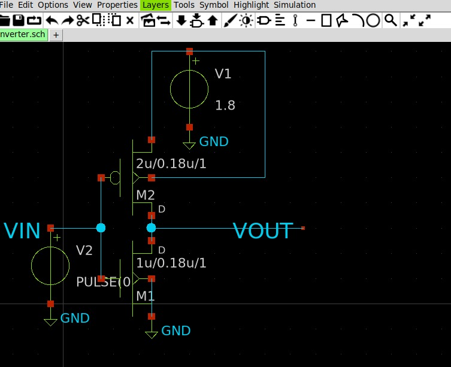
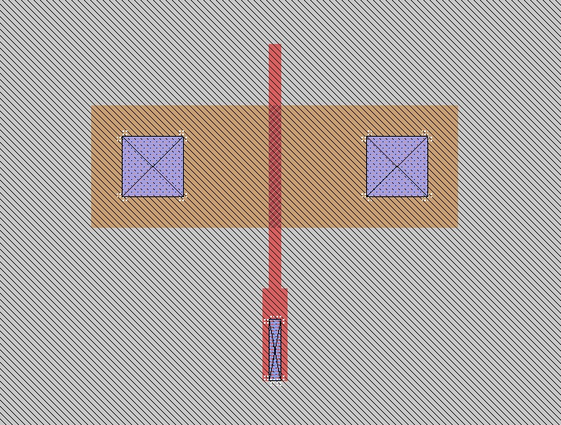

# SKY130 Physical Verification Project

## 1. Project Overview

This project explores CMOS inverter design, schematic capture, pre-layout circuit simulation, and the physical verification workflow using open-source Electronic Design Automation (EDA) tools and the SKY130 Process Design Kit (PDK).

The project includes a generic CMOS inverter schematic and simulation, SKY130 technology exploration, and preliminary physical layout work using Magic.

## 2. Project Screenshots

### CMOS Inverter Schematic

*Transistor-level CMOS inverter schematic created using Xschem.*

### Physical Layout — Work in Progress

*Preliminary layout created in Magic using the SKY130A technology. Design-rule verification is still in progress.*

### Simulation Waveform

*Generic CMOS inverter transient simulation. The simulation uses generic Level-1 transistor models, not SKY130-specific device models.*

## 3. SKY130 Process Design Kit (PDK)

The SKY130 PDK provides technology-specific information used in integrated-circuit design and physical verification.

It includes:
- Technology and process-layer definitions.
- NMOS and PMOS device information.
- Design rules and layout constraints.
- Standard-cell libraries and technology data.
- Files supporting EDA tools such as Magic and circuit simulators.

The PDK defines how devices and physical layers are represented and checked for a particular manufacturing process.

**Note:** The generic transistor simulation in this repository is not a SKY130 model-based simulation.

## 4. Basic CMOS Process Layers

Common layers encountered in CMOS layout include:

- **N-well:** Region used to form PMOS devices in a typical bulk CMOS process.
- **Active/diffusion:** Region where transistor source and drain structures are formed.
- **Polysilicon:** Commonly used to form transistor gates.
- **Metal layers:** Conductive layers used for circuit interconnections.
- **Contacts and vias:** Structures connecting diffusion, polysilicon, and metal layers.
- **Implant layers:** Define doped semiconductor regions.
- **Well and substrate taps:** Provide electrical connections to wells and substrate regions.

Exact layer names, functions, and permitted geometries depend on the technology and PDK definitions.

## 5. NMOS and PMOS Transistors

A MOSFET is a voltage-controlled semiconductor device with four terminals: gate, source, drain, and body.

### NMOS

An NMOS transistor turns on when its gate-to-source voltage sufficiently exceeds its threshold voltage. In a basic CMOS inverter, it connects the output toward ground when the input is HIGH.

### PMOS

A PMOS transistor turns on when its source-to-gate voltage sufficiently exceeds the magnitude of its threshold voltage. In a basic CMOS inverter, it connects the output toward the positive supply when the input is LOW.

## 6. CMOS Inverter Operation

A CMOS inverter uses one PMOS transistor and one NMOS transistor. Their gates connect to the input, and their drains connect to the output. The PMOS source connects to the positive supply, while the NMOS source connects to ground.

| Input | PMOS | NMOS | Expected output |
|---|---|---|---|
| LOW (0 V) | ON | OFF | HIGH (approximately VDD) |
| HIGH (approximately VDD) | OFF | ON | LOW (approximately 0 V) |

The Boolean operation is:

**Y = NOT(A)**

Ideally, steady-state CMOS logic consumes very little static power, although real circuits have leakage and dynamic switching power.

## 7. Open-Source EDA Workflow

The general workflow for a CMOS circuit is:

1. **Xschem:** Draw the transistor-level schematic.
2. **SPICE netlisting:** Represent circuit components and electrical connections in text form.
3. **ngspice:** Run circuit simulations using appropriate device models.
4. **Magic:** Create and inspect the physical layout using the technology definitions.
5. **DRC:** Check the layout against process design rules.
6. **LVS:** Compare extracted layout connectivity against the reference schematic.
7. **Parasitic extraction:** Estimate parasitic resistance and capacitance for further simulation.

A successful schematic simulation does not establish that a layout is physically valid or electrically equivalent to the schematic.

## 8. CMOS Inverter Simulation

The repository contains an Xschem schematic and SPICE netlists for a generic CMOS inverter.

Simulation setup:

- Supply voltage: 1.8 V
- NMOS model: Generic Level-1
- PMOS model: Generic Level-1
- NMOS dimensions: W = 1 µm, L = 0.18 µm
- PMOS dimensions: W = 2 µm, L = 0.18 µm
- Output load: 10 fF
- Transient stop time: 30 ns
- Maximum requested time step: 50 ps

The input pulse transitions between 0 V and 1.8 V. The ngspice batch simulation completed and generated 650 transient data rows.

The initial operating point showed an input near 0 V and an output near 1.8 V, consistent with the expected inverter state for a LOW input.

**Limitation:** These results use generic Level-1 transistor models and do not establish SKY130-specific electrical performance. The saved waveform data is located at `My_Inverter/results/inverter_waveform.csv`.

## 9. Physical Verification

### Design Rule Check (DRC)

DRC checks layout geometry against manufacturing constraints, including minimum width, spacing, enclosure, and overlap.

The current Magic layout reports a local-interconnect diffusion-contact enclosure violation (`li.5`). The layout is therefore **not yet DRC-clean**.

### Layout Versus Schematic (LVS)

LVS compares the circuit extracted from the physical layout against the reference schematic. It checks device types, connectivity, and other supported properties.

**LVS has not yet been completed for this layout.**

DRC checks physical geometry, while LVS checks electrical correspondence. Both are required for a properly verified design.

## 10. Project Files

- `My_Inverter/inverter.sch` — Xschem inverter schematic.
- `My_Inverter/inverter_pre.sp` — Generic SPICE netlist.
- `My_Inverter/inverter_test.sch` — Testbench schematic.
- `My_Inverter/inverter_layout.mag` — Preliminary Magic layout.
- `My_Inverter/results/` — SPICE netlists, simulation log, and waveform data.
- `My_Inverter/screenshots/` — Project screenshots for documentation.

## 11. Tools Used

- **Xschem:** Schematic capture.
- **ngspice:** Circuit simulation.
- **Magic:** Physical layout creation and inspection.
- **Netgen:** Intended for layout-versus-schematic comparison when configured with the appropriate LVS tool and setup.
- **SKY130A PDK:** Technology definitions, device information, and design rules.
- **Git and GitHub:** Version control and project documentation.

## 12. Current Status and Future Work

Completed:
- Created the generic CMOS inverter schematic.
- Ran the generic transient simulation and saved waveform data.
- Loaded the SKY130A technology in a locally built Magic installation.
- Started creating a preliminary physical layout.
- Committed project files to GitHub.

In progress:
- Correcting layout design-rule violations.
- Completing the required implant layers, contacts, and electrical connections.
- Verifying well/substrate connections and layout geometry.
- Running DRC until the layout passes the applicable rules.
- Performing LVS against the reference schematic.

The current layout is a work in progress. No clean DRC or successful LVS result is claimed.

## 13. Conclusion

This project demonstrates the CMOS inverter concept, schematic capture, generic pre-layout simulation, and initial exploration of SKY130 physical layout using open-source EDA tools.

Further work is required to complete the technology-specific layout and establish successful DRC and LVS results.
